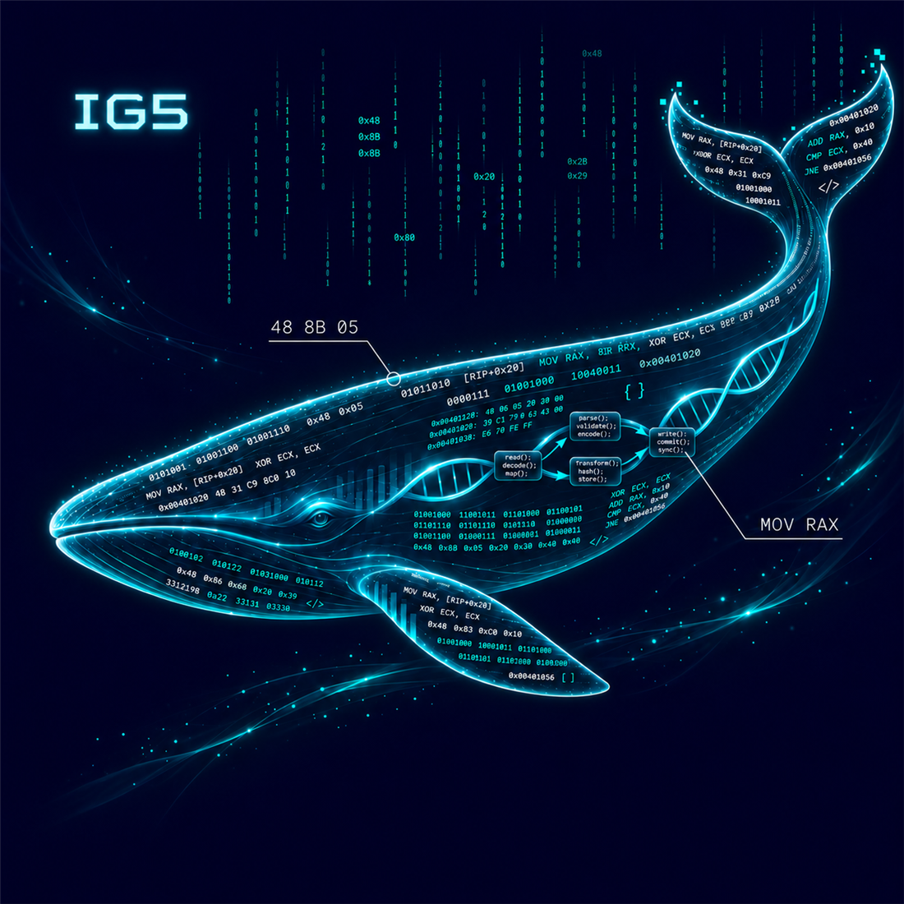
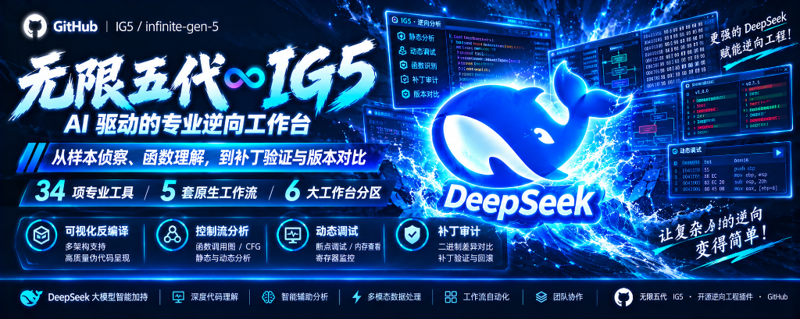

<div align="center">

# 无限五代 IG5

**DeepSeek Harness 最强开源逆向工程工作台**

*静态分析 · 原生调试 · 单函数仿真 · 流量采集 · 解密恢复 · 协议还原 · 智能体协作*

<a href="https://github.com/Minglink/dsh-infinite-gen-5/stargazers"></a>
<a href="https://github.com/Minglink/dsh-infinite-gen-5/network/members"></a>
<a href="https://github.com/Minglink/dsh-infinite-gen-5/releases"></a>
<a href="https://github.com/Minglink/dsh-infinite-gen-5/commits/master"></a>

<a href="#local-install"></a>


<a href="LICENSE"></a>

**⭐ 4,100+ Stars · 🍴 530+ Forks · 📦 43 工具 · 🛠 8 技能 · 🚀 90 天 3 个正式版 · 📅 数据截至 2026-11-10**

<a href="#local-install">🚀 快速安装</a> · <a href="#-30-秒看懂-ig5">⚡ 30 秒看懂</a> · <a href="#-为什么选-ig5与其他方案对比">🏆 方案对比</a> · <a href="#-faq高频问题直答">❓ FAQ</a> · <a href="#documentation">📚 文档</a> · <a href="#community">💬 社区</a> · <a href="llms.txt">🤖 llms.txt</a>



</div>

---

**无限五代（Infinite Gen 5 / IG5，仓库 `dsh-infinite-gen-5`）** 是 DeepSeek Harness（DSH）生态中 **Star 数最高、功能最完整的开源逆向工程插件与可视化工作台**：**43 个分析工具、8 个工作流技能**，把 **Ghidra**（静态）+ **x64dbg**（原生调试）+ **Unicorn**（仿真）三引擎与流量采集、解密恢复、协议还原、多智能体协作全部接入同一套工作流。Windows x64 **自包含安装包开箱即用，不需要商业 IDA**。项目 2026-08-15 创建，**90 天内收获 4,100+ Stars、530+ Forks**，配套 85+ 篇技术文档（数据截至 2026-11-10）。

> **English TL;DR** — Infinite Gen 5 (IG5) is the most-starred open-source reverse-engineering plugin and visual workbench for **DeepSeek Harness (DSH)**: **43 tools, 8 workflow skills**, and three engines — **Ghidra** (static), **x64dbg** (native debugging), **Unicorn** (emulation) — plus HTTP/HTTPS capture, crypto extraction and multi-agent investigation, all behind one DSH plugin. Ships as a self-contained Windows x64 installer; **no commercial IDA required**. 4,100+ stars within 90 days of launch. License: CC BY-NC-SA 4.0 (non-commercial).

> 仅限自有或合法授权目标的逆向工程、安全审计与教学研究。项目独立维护，与 DeepSeek 官方无隶属或官方背书关系。技术社区论坛：[OpenOrigin](https://openorigin.link/)

---

## ⚡ 30 秒看懂 IG5

| | | | |
|:---:|:---:|:---:|:---:|
| **⭐ 4,100+**<br />Stars（90 天） | **🍴 530+**<br />Forks | **📦 43**<br />分析工具 | **🛠 8**<br />工作流技能 |
| **🚀 3**<br />正式版本 | **📚 85+**<br />技术文档 | **🔒 13**<br />审批安全门 | **🆕 v1.3.0**<br />2026-10-27 |

<details open>
<summary><b>核心速览</b></summary>

| 项目 | 数据（截至 2026-11-10） |
| :--- | :--- |
| 定位 | DeepSeek Harness（DSH）生态最强开源逆向工程插件与可视化工作台 |
| 工具面 | **43 个工具** = Core 8（默认）+ 28 静态入口 + 13 审批入口 + 2 生命周期 |
| 工作流技能 | **8 个原生技能**（triage / deep-dive / patch-and-sign / diff / debug-live / crypto / protocol / reverse-agent） |
| 斜杠命令 | **10 条** `/ig5 *` 宿主命令，无需模型先生成工具调用 |
| 分析引擎 | **Ghidra**（静态）+ **x64dbg**（原生调试）+ **Unicorn**（单函数仿真） |
| 网络能力 | 内置 HTTP/HTTPS 采集、显式 TLS 解密、PCAP/PCAPNG 解析、请求重放 |
| 安装方式 | Windows x64 **自包含安装包**（内置 Ghidra/JDK/Python、x64dbg/bridge），解压 + 一条命令 |
| 宿主兼容 | `@deepseek-ai/dsh >=0.2.0-rc.1 <0.3.0-0`（已验证 `0.2.1-alpha.1`） |
| 许可 | CC BY-NC-SA 4.0（免费开源，非商业使用） |

</details>

## 🏆 为什么选 IG5（与其他方案对比）

| 能力维度 | **IG5** | IDA Pro | 裸 Ghidra | 通用 MCP 插件 |
| :--- | :---: | :---: | :---: | :---: |
| DSH 智能体工作流原生集成 | ✅ | ❌ | ⚠️ 需自建脚本 | ⚠️ 浅层封装 |
| 静态 + 调试 + 仿真三引擎一体 | ✅ | ⚠️ 需付费插件 | ⚠️ | ❌ |
| 内置 HTTP/HTTPS 采集与 TLS 解密 | ✅ | ❌ | ❌ | ❌ |
| 子代理协作 · 持久调查 · 证据 dossier | ✅ | ❌ | ❌ | ❌ |
| 自包含安装（免商业授权） | ✅ 一次解压 | ❌ 需购买授权 | ⚠️ 手动配环境 | ⚠️ |
| AI 审批安全模型 + 审计回溯 | ✅ | ❌ | ❌ | ❌ |
| 成本 | **免费** | 数千美元/席位 | 免费 | 免费 |

**五个决定性差异：**

1. **生态内唯一全链路** — 静态分析、原生调试、单函数仿真、流量采集、解密恢复、协议还原、去混淆研究与子代理协作，一个插件全覆盖，不需要在多个工具之间搬运上下文。
2. **AI 原生证据链** — 单函数 dossier（伪代码 + CFG + 调用关系 + 栈帧，同一数据库修订）、持久调查任务、stale 证据标记、共享调用预算——把"模型推测"与"已验证结论"分开，这是给 AI 用的逆向工作台与 GUI 套壳的本质区别。
3. **零配置自包含** — 完整安装包内置 Ghidra/JDK/Python 与 x64dbg/bridge 及上游源码、许可与哈希清单，一次解压 + 一条 PowerShell 命令完成安装，全程不需要商业 IDA。
4. **审批安全模型** — 13 个修改/执行入口全部经过宿主审批（`allowed-once`），配合 Undo、审计流水与 SHA-256 哈希清单，适合团队与教学环境的可控授权分析。
5. **增长最快的 DSH 逆向插件** — 上线 90 天 4,100+ Stars、530+ Forks，Star 增速居 DSH 插件生态首位；85 篇文档与 Release 节奏持续更新。

## ✨ 七大能力域

| 方向 | 主要能力 | 使用边界 |
| :--- | :--- | :--- |
| 🔍 静态分析 | 函数、字符串、交叉引用、反编译、CFG、类型、结构体、虚表与跳转表检视 | 支持情况依赖具体后端；部分分析与未决结果保留标记 |
| 🖼 可视化工作台 | SVG CFG 平移/缩放、双击查看汇编、局部变量焦点高亮、结构体草稿与审计时间线 | 焦点行过滤不等于完整污点分析；编辑草稿仍需发送并审批 |
| 🐞 调试与仿真 | x64dbg 原生调试、断点、寄存器/内存、受限轨迹；Unicorn 单函数仿真 | 执行需要授权和审批；仿真不提供完整 OS、import 或 TLS 环境 |
| 🌐 HTTP/HTTPS 采集 | 本机代理、显式 TLS 解密、流量历史、证据导出、请求重放与下发载荷提取 | 仅批准 origin；不自动修改系统代理或证书信任，不等同完整 Burp 功能 |
| 🔐 解密与协议 | 编码/压缩检查、XOR/AES、有界候选检索、PCAP/PCAPNG 解析、分帧与观察状态模型 | 不保证未知密钥恢复或隐藏服务器语义；缺口、冲突与外推假设保留 |
| 🧩 IR 与去混淆研究 | 真实 p-code/SSA、单函数只读去混淆覆盖层、路径投影、状态组合与离线轨迹恢复 | 局部模型或数学证明不等于通用去壳、完整 VM 或业务恢复 |
| 🤝 调查与子代理协作 | 单函数 dossier、持久调查任务、受控 handoff、证据回交与根会话共享调用预算 | DSH 负责派工；插件核验身份/证据/生命周期，不认证模型理解或结论正确性 |

**典型适用场景**（按优先级）：

1. 新样本快速分诊 — 架构识别、字符串/熵扫描、关键函数定位（`/ig5-triage`）
2. 单函数深挖与类型恢复 — 伪代码、CFG、调用方/被调方、栈帧一次拿全（`ig5_decompile style=dossier`）
3. 授权目标的动态验证 — 断点、寄存器、内存、API 轨迹（`/ig5-debug-live`）
4. 通信协议与配置提取 — 抓包分帧、XOR/AES 候选、状态模型验证（`/ig5-protocol`、`/ig5-crypto`）
5. 版本差异与补丁分析 — `ig5_bindiff` 候选变更块 + 调用关系/常量/虚表核验（`/ig5-diff`）
6. 长周期自主调查 — 持久任务、证据保存、失败分流、子代理 handoff（`/ig5-reverse-agent`）

能力边界与逐项验收记录见 [能力矩阵](docs/CAPABILITIES.md) 与 [已知限制](docs/LIMITATIONS.md)。

---

## 🚀 快速安装

### Windows x64（推荐，约 3 分钟）

需要已安装的 DeepSeek Harness profile。完整包内置 Ghidra/JDK/Python、x64dbg/Python/bridge 和上游源码、许可及哈希清单；**不需要商业 IDA 安装**，DSH 本身不随包提供。

1. 从 [v1.3.0 Release](https://github.com/Minglink/dsh-infinite-gen-5/releases/tag/v1.3.0) 下载 `IG5-1.3.0-Windows-x64-portable-full.zip` 和同名 `.sha256`，核对 SHA-256：`04273147dde23976a625c582773c33ca1df7b851da0bd5a6e52e2a7c6530b815`
2. 完整解压，保留 `plugin/`、`manifest.json` 及所有运行资产；不要只复制安装脚本
3. 在解压根目录打开 PowerShell，执行：

```powershell
& .\plugin\install.ps1
```

4. 完全退出并重启 DSH，执行 `/ig5 engines` 和 `ig5_doctor` 检查实际可用性
5. 本地 1.3.0 安装后用 `ig5_profile` 核对 `version=1.3.0`、`implementationRevision=20261026-release-1.3.0`，确认新实现已加载

> [!NOTE]
> **Source code ZIP / tar.gz 与 git clone 是维护源码，不是完整离线安装包。** 普通安装请下载上述命名的 Windows 完整 ZIP。仅切换插件开关可能复用旧模块，更新后应冷启动 DSH。

<details>
<summary>📦 源码安装、离线资产复用与修复</summary>

在最新源码根目录执行：

```powershell
& .\install.ps1
```

源码安装器首次联网获取固定供体，仅补齐 `runtimes/` 和 `third_party/sources/`，不覆盖当前插件代码。`scripts/distribution.json` 仍固定到 [1.0.0 资产基线](https://github.com/Minglink/dsh-infinite-gen-5/releases/tag/v1.0.0-dsh021-20261010)，这只是原生依赖供体，不表示当前源码回退到 1.0.0。

已有原始固定 ZIP 时可离线复用，文件必须放在源码目录之外：

```powershell
& .\install.ps1 -DistributionArchive 'D:\IG5-1.0.0-Windows-x64-dsh021-full-20261010.zip' -Offline
```

固定供体 ZIP 的 SHA-256：`a2459ddca1f19e5eec2d7918c504f133889809800a0b277e1e379d3ce1459b54`。这是 **1.0.0 供体**的校验值，不是 1.3.0 完整 ZIP 的校验值。

也可使用已核验、包含 `manifest.json` 和 `plugin/` 的完整解压根目录：

```powershell
& .\install.ps1 -DistributionRoot 'C:\已解压的完整发行包根目录' -Offline
```

`-DistributionArchive` 与 `-DistributionRoot` 不能同时使用。只传 `-Offline` 但缺少完整资产时，安装器会拒绝并给出指引。

包含 `-RepairAssets` 参数的新安装器完整包，在核心代码仍与外层清单一致时，可显式修复运行资产：

```powershell
& .\plugin\install.ps1 -RepairAssets -DistributionArchive 'D:\IG5-1.0.0-Windows-x64-dsh021-full-20261010.zip' -Offline
```

不要把新安装脚本单独拷入旧的哈希封存包。SHA 不符时保留相对路径、Expected/Actual SHA-256 和大小，先核对原始 ZIP；不能直接归咎某个解压工具。维护者重建说明见 [BUILD](docs/BUILD.md)。

</details>

### 其他平台与宿主兼容

- **macOS Apple Silicon** — 实验性 `darwin-arm64` Ghidra 静态车道，需要独立准备运行包；Windows ZIP 和 `install.ps1` 不适用。不支持 x64dbg/Windows 原生调试，也不包含可用的 macOS Unicorn 运行时。见 [macOS 指南](docs/MACOS_RUNTIME.md)
- **Android / iOS** — 未完成真机验收或原生运行包。支持 ARM64 目标分析，不等于支持手机宿主
- **DSH** — 声明范围为 `@deepseek-ai/dsh >=0.2.0-rc.1 <0.3.0-0`，宿主按 `includePrerelease: true` 判断。已记录验证的宿主为 `0.2.1-alpha.1`，不代表范围内所有版本都实测通过。见 [兼容记录](docs/DSH_COMPATIBILITY.md)

## 🧭 开始一次调查（5 步）

1. 用 `/ig5 engines` 确认后端，再用 `/ig5 open --engine ghidra <样本路径>` 打开目标；打开不启动样本
2. 从函数、字符串和交叉引用定位问题，用 `ig5_decompile style=dossier` 获取同一修订下的伪代码、CFG、调用关系和栈帧证据
3. 需要持续调查时，通过 `ig5_workspace` 保存目标、进度与假设；旧 attachment 或修订的证据会标为 stale。详见 [调查工作流](docs/INVESTIGATION_WORKFLOW.md)
4. 需要高级工具时切换 Full 43；补丁、调试、仿真、重放等操作仍须单独审批
5. 子代理任务由 DSH 原生派工。IG5 支持 `handoff → claim → evidence → submit → 子代理完成 → review`，正式复核必须绑定同一交接和实际生命周期。见 [子代理工作流](docs/SUBAGENT_WORKFLOW.md)

父、子及后代共享的 IG5 调用预算须显式启用，例如 `ig5_profile collaboration={action:"start",max_calls:20}`；状态查询用 `collaboration={action:"status"}`。额度不从提示词自动推断，不计 token 或非 IG5 工具；重复 start 或重载不能放大额度。证据提交和正式复核仍不等于语义结论认证。

## ⌨️ 常用指令与工具

### 斜杠命令

```text
/ig5 status
/ig5 engines
/ig5 open --engine ghidra <样本路径>
/ig5 toolset full
/ig5 toolset core
/ig5 deobfuscate --engine ghidra <十六进制函数地址> <样本路径>
/ig5 state <轨迹JSON完整路径>
/ig5 state-validate <推断报告UUID> <新轨迹JSON完整路径>
/ig5 export --engine ghidra <样本路径>
```

斜杠命令直接走宿主命令入口，无需模型先生成工具调用。`state-validate` 默认验证保存的前缀树；验证合并假设需用 `ig5_protocol` 显式指定模型。

### Core 8 / Full 43

默认 **Core 8**：`ig5_doctor`、`ig5_open`、`ig5_status`、`ig5_funcs`、`ig5_strings`、`ig5_decompile`、`ig5_close`、`ig5_profile`

**Full 43** = **28 非审批静态入口 + 13 审批入口 + 2 生命周期/配置**。"静态"指不执行目标、不开引擎、不发网络，但不等于不写文件：`ig5_workspace` 会更新本会话任务存储并写不可变报告，`ig5_recovery` 会写不可变报告，`ig5_package unpack` 会写解包文件。支持 scoped API 的 DSH 只向当前 agent 展开 Full；旧宿主明确返回 `toolsetScope=plugin-instance`。切换不持久化，也不授予执行或写入权限。

<details>
<summary><b>📄 展开完整工具清单（43）</b></summary>

**静态、无目标执行（28）**

`ig5_doctor` · `ig5_open` · `ig5_status` · `ig5_funcs` · `ig5_strings` · `ig5_decompile` · `ig5_xrefs` · `ig5_calls` · `ig5_bytes` · `ig5_search` · `ig5_listing` · `ig5_scan` · `ig5_export_diff` · `ig5_cfg` · `ig5_slice` · `ig5_fingerprint` · `ig5_stack` · `ig5_switches` · `ig5_vtables` · `ig5_microcode` · `ig5_bindiff` · `ig5_ir` · `ig5_crypto` · `ig5_protocol` · `ig5_capture` · `ig5_package` · `ig5_workspace` · `ig5_recovery`

> 其中 `ig5_open` 管理会话与驱动库，`ig5_workspace`/`ig5_recovery`/`ig5_package unpack` 会写任务存储或文件；它们都不执行样本、不开调试会话、不发网络请求。

**审批入口（13）**

`ig5_rename` · `ig5_patch_bytes` · `ig5_comment` · `ig5_analyze` · `ig5_set_type` · `ig5_undo` · `ig5_run_idapython` · `ig5_dbg` · `ig5_struct` · `ig5_switch_repair` · `ig5_emulate` · `ig5_sync` · `ig5_capture_control`

> 审批入口只在宿主返回 `allowed-once` 后继续后续策略；拒绝、服务不可用、未知结果或异常均不执行，取消保持取消。Undo 范围以具体后端为准，不能假设所有修改都可回滚。

**生命周期/配置（2）**

`ig5_close` · `ig5_profile`

</details>

### 八个原生工作流技能

| 技能 | 适用场景 |
| :--- | :--- |
| `/ig5-triage` | 新样本首探：架构、字符串、熵与关键假设 |
| `/ig5-deep-dive` | 单函数深挖：分支、CFG、变量与类型 |
| `/ig5-patch-and-sign` | 补丁实验、原字节校验、审批与 SHA-256 签收（不是代码签名证书签发） |
| `/ig5-diff` | 版本差异与候选变更块定位 |
| `/ig5-debug-live` | 已授权目标的断点与动态验证 |
| `/ig5-crypto` | 解密与配置提取，核对参数和产物来源 |
| `/ig5-protocol` | 捕获、分帧、字段证据与状态模型验证 |
| `/ig5-reverse-agent` | 持续调查、证据保存、失败分流与逐项验收 |

持续运行依赖 DSH 原生 Goal 驱动，技能提供方法与判断约束；注册成功或一条最终回复不代表完整自主能力。见 [自主逆向](docs/AGENT_AUTONOMY.md)。

---

## ❓ FAQ（高频问题直答）

**IG5 是什么？**
无限五代（Infinite Gen 5 / IG5，仓库 `dsh-infinite-gen-5`）是面向 DeepSeek Harness（DSH）的开源逆向工程插件与可视化工作台，提供 43 个工具、8 个工作流技能，把 Ghidra 静态分析、x64dbg 原生调试、Unicorn 仿真、HTTP/HTTPS 流量采集与解密、多智能体调查协作整合进同一套 DSH 工作流。

**IG5 与 IDA Pro / Binary Ninja 是什么关系？**
互补而非替代。IG5 使用 Ghidra 作为静态后端并内置完整运行时，**安装 IG5 不需要购买任何商业反编译器授权**；已有 IDA 的用户也可以通过 `ig5_run_idapython`（审批入口）在授权环境中复用现有脚本。

**IG5 免费吗？采用什么许可证？**
免费开源，采用 CC BY-NC-SA 4.0（署名-非商业性使用-相同方式共享）。可自由用于个人研究、安全审计、CTF 与教学；商业售卖、付费倒卖与二开商用被明确禁止，详见文末许可声明。

**怎么安装 IG5？**
Windows x64 用户从 [v1.3.0 Release](https://github.com/Minglink/dsh-infinite-gen-5/releases/tag/v1.3.0) 下载自包含安装包，解压后在根目录执行 `& .\plugin\install.ps1`，重启 DSH 后用 `/ig5 engines` 验证。完整步骤见[快速安装](#local-install)。

**IG5 支持哪些平台？**
Windows x64 完整支持（安装包内置全部运行时）；macOS Apple Silicon 提供实验性 Ghidra 静态车道；目标侧支持 x86/x64/ARM64 等架构的静态分析。详见 [macOS 指南](docs/MACOS_RUNTIME.md) 与 [DSH 兼容记录](docs/DSH_COMPATIBILITY.md)。

**IG5 能做什么、不能做什么？**
能做：静态分析、可视化 CFG 工作台、原生调试、单函数仿真、流量采集与 TLS 解密、XOR/AES 解密候选、协议分帧与状态建模、CFF/VM 去混淆研究、子代理协作调查。边界：所有执行/修改类操作需宿主审批；不承诺"任意保护一键脱壳"；局部模型不外推为通用恢复。完整口径见 [能力矩阵](docs/CAPABILITIES.md) 与 [已知限制](docs/LIMITATIONS.md)。

**IG5 和 DeepSeek 官方是什么关系？**
完全独立的第三方开源项目，与 DeepSeek 官方或其关联主体无隶属、无商业合作、无官方背书。IG5 通过 DSH 插件机制扩展宿主能力，DSH 本身不随 IG5 分发。

**为什么 IG5 要做 13 个审批门？**
安全模型设计。所有修改字节、执行样本、仿真、重放、采集控制入口都必须经宿主显式审批（`allowed-once`），配合 Undo、审计流水与 SHA-256 哈希清单，让 AI 驱动的逆向操作在授权范围内可审计、可控、可回溯——这是 IG5 与"裸工具包"类插件的核心差异。

**IG5 的版本节奏如何？**
2026-08-15 创建以来已发布 v1.0.0、v1.1.0、v1.3.0 三个正式版本（90 天内），当前最新版 v1.3.0（2026-10-27）将工具面扩展至 Full 43 并新增 APK/固件静态前端、API trace 与 CFF 状态分析。历史版本见 [Releases](https://github.com/Minglink/dsh-infinite-gen-5/releases)。

**如何在论文/报告中引用 IG5？**
推荐引用格式：`Minglink, "Infinite Gen 5 (IG5): An Open-Source Reverse-Engineering Workbench Plugin for DeepSeek Harness", GitHub repository dsh-infinite-gen-5, 2026. https://github.com/Minglink/dsh-infinite-gen-5`（引用时请注明所用版本号与访问日期）。

---

## 📚 使用文档

| 主题 | 文档入口 |
| :--- | :--- |
| 能力与边界 | [能力矩阵](docs/CAPABILITIES.md) · [已知限制](docs/LIMITATIONS.md) · [工具面与预算](docs/TOOL_SURFACE.md) |
| 安装、构建与兼容 | [构建与资产](docs/BUILD.md) · [DSH 兼容](docs/DSH_COMPATIBILITY.md) · [macOS](docs/MACOS_RUNTIME.md) |
| 调查与协作 | [调查任务与 dossier](docs/INVESTIGATION_WORKFLOW.md) · [子代理交接与共享预算](docs/SUBAGENT_WORKFLOW.md) · [自主逆向](docs/AGENT_AUTONOMY.md) |
| 流量、解密与协议 | [独立采集](docs/CAPTURE.md) · [解密与协议工作流](docs/CRYPTO_PROTOCOL.md) · [去混淆与协议状态](docs/DEOBFUSCATION_STATE.md) · [流量样本对应](docs/TRAFFIC_CORRELATION.md) · [API 轨迹](docs/API_TRACE.md) |
| 调试与隔离环境 | [原生轨迹与离线恢复](docs/TRACE_RECOVERY.md) · [VMCI 客体调试](docs/GUEST_DEBUG.md) · [可选 ScyllaHide](docs/SCYLLAHIDE.md) |
| IR 与状态分析 | [路径发现](docs/PATH_DISCOVERY.md) · [状态投影](docs/STATE_PROJECTION.md) · [Java 解码](docs/JAVA_PROJECTION.md) · [状态组合](docs/STATE_COMPOSITION.md) · [Mergen 提升（实验性）](docs/LIFTER.md) |
| 样本与验证范围 | [复杂保护样本库](docs/PROTECTION_CORPUS.md) · [现代保护自产样本](docs/MODERN_PROTECTION_CORPUS.md) · [实验规划](docs/EXPERIMENT_PLANNER.md) · [研究性质](docs/RESEARCH_PROPERTIES.md) |
| 发布记录 | [v1.3.0](docs/RELEASE_1.3.0.md) · [v1.1.0](docs/RELEASE_1.1.0.md) · [VM 研究推进](docs/VM_RESEARCH_PROGRESSION.md) · [真实使用反馈改造](docs/UXR_USAGE.md) |

<details>
<summary><b>🔬 进阶研究索引：录制、VM 假设与局部证明</b></summary>

以下是有明确输入、预算和验收范围的研究组件，不是"任意保护自动恢复"能力清单。旧实验失败、unknown 和未验证前提仍保留在对应文档中。

- **研究框架**：[完整 VM 业务恢复框架](docs/VM_RECOVERY_FRAMEWORK.md)、[参考方法审查](docs/REVERSE_WORKFLOW_SOURCE_REVIEW.md)、[VM 模型研究边界](docs/VM_MODEL_RESEARCH.md)
- **录制观察**：[统一观察层](docs/VM_OBSERVATIONS.md)、[存储位置前后字节](docs/NATIVE_STORE_EVENTS.md)、[寻址与角色候选](docs/VM_ADDRESS_ROLES.md)
- **取流与主体**：[取流依赖与主体恢复](docs/VM_FETCH_FLOW.md)、[多主体上下文候选](docs/VM_CONTEXT_MODEL.md)
- **状态表示**：[transition-chain](docs/TRANSITION_CHAIN.md)、[未知效果投影](docs/OPAQUE_PROJECTION.md)、[未知效果组合](docs/OPAQUE_COMPOSITION.md)、[标志映像投影](docs/OPAQUE_STATUS_PROJECTION.md)、[标志映像组合](docs/OPAQUE_STATUS_COMPOSITION.md)
- **有限指令与接点证明**：[CALL rel0](docs/CALL_REL0.md)、[入口链条件域](docs/ENTRY_CHAIN_DOMAIN.md)、[上下文写入接点](docs/CONTEXT_WRITE_JOIN.md)、[槽 200](docs/CONTEXT200_JOIN.md)、[槽 208](docs/CONTEXT208_JOIN.md)、[处理器 208 搬栈](docs/HANDLER208_RELOCATION.md)、[阶段和代码版本](docs/VM_PHASE_MODEL.md)、[LCM 历史恢复](docs/LCM_MEMORY.md)

加载成功、生成 IR、局部相等、结构复核与真实业务恢复分别验收；不据此宣称完整 CPU、通用 VM、精确 VMP 3.8 或任意目标业务通过。

</details>

<details>
<summary><b>🏗️ 项目结构</b></summary>

```text
dsh-infinite-gen-5/
├── index.js / client.js       # 宿主工具与可视化工作台
├── workflow.js               # 命令、八个技能与生命周期
├── source/                   # 身份/地址、调查协作、采集与数据分析
├── adapters/                 # Ghidra、x64dbg 与独立内核适配
├── worker/                   # Reverse worker、仿真与轨迹依赖
├── skills/                   # 八个逆向工作流
├── runtimes/                 # 完整包中的运行资产
├── third_party/              # 上游来源、许可、构建补丁与清单
├── scripts/                  # 语法检查、回归、安装与打包维护
├── docs/                     # 85+ 篇使用指南、研究记录与验收边界
├── assets/                   # 海报与社区图片
├── install.ps1               # Windows 安装
└── uninstall.ps1             # 卸载
```

维护源码不包含完整运行资产。测试应区分语法、SDK/renderer fixture、真实后端执行和实际 DSH 模型调用；不能用工具注册或旧报告代替本轮功能验证。维护命令与范围见 [BUILD](docs/BUILD.md) 和 [维护约定](AGENTS.md)。

</details>

---

## 🔄 版本更新

> 🆕 最新正式版 **v1.3.0（2026-10-27）** · 本 README 数据截至 **2026-11-10** · 全部版本见 [Releases](https://github.com/Minglink/dsh-infinite-gen-5/releases)

### v1.3.0 · 2026-10-27

工具面由 Full 40 扩展至 Full 43，同时保持 Core 8、13 个审批门、既有预算和能力限制不变。

- **工具与调查入口** — 新增 `ig5_package`（APK/固件静态前端），并从 `ig5_profile` 拆出 `ig5_workspace` 与 `ig5_recovery`；增加持久函数结果、认证游标分页、最多 72 个函数的持久批处理和大型反编译结果完整重组
- **静态分析** — 增加 APK、固件、规则匹配、加壳特征、行为清单以及字符串与配置解码能力
- **动态与网络分析** — 增加 x64dbg API trace、CPU 写入/代码版本轨迹，以及已保存 HTTP 交换与本地样本的离线对应
- **VM 与去混淆研究** — 增加代码 epoch、阶段上下文、VM 角色/实例、CFF 状态分析、位向量候选和独立验证回执；这些能力仍受证据边界约束，不等于通用恢复任意 VMP 或业务逻辑

完整变更、审查口径与能力边界见 [v1.3.0 Release](https://github.com/Minglink/dsh-infinite-gen-5/releases/tag/v1.3.0) 和 [1.3.0 说明](docs/RELEASE_1.3.0.md)。

### v1.1.0 · 2026-10-20

引入独立 HTTP/HTTPS 采集、受控子代理交接与共享 IG5 调用预算，并修复 PE 导出表与分析入口混淆。

- **独立采集** — 新增 `ig5_capture` / `ig5_capture_control`，支持有界 HTTP/HTTPS 证据流与离线载荷检查，不依赖 Burp 程序
- **受控协作** — 交接绑定真实 DSH 父子会话；子代理读取、提交证据并实际完成后，父代理才能进行正式复核
- **共享预算** — 显式启用后，父、子及后代 IG5 调用统一计账，已分发失败调用也计数；重载不会清零
- **导出表修复** — 真实 PE 导出目录与分析入口、TLS 回调分开处理，转发项、无名项与 partial 诊断保留

详见 [v1.1.0 Release](https://github.com/Minglink/dsh-infinite-gen-5/releases/tag/v1.1.0) 与 [1.1.0 发布说明](docs/RELEASE_1.1.0.md)。

---

## 💬 官方交流社区

> 📌 **非盈利开源公益项目，严禁任何主体用于商业售卖、付费倒卖或黑灰产牟利，仅供技术研究交流。**

- 🔴 红队安全交流 11 群：`1043279187`
- 📺 腾讯频道技术交流社区：`pd86424753`
- 🌐 技术研究论坛：[OpenOrigin](https://openorigin.link/)
- 🛒 插件生态市场：[DeepSeek Harness Hub](https://deepseek.stream/)（生态入口不代表官方背书）

<p align="center">
  
</p>

---

## 📄 开源协议与非商用特别声明（License）

本项目采用 **[CC BY-NC-SA 4.0（署名-非商业性使用-相同方式共享 4.0 国际许可协议）](LICENSE)** 进行开源，并附加以下严格的法律与商业限制条款：

1. 🚫 **严禁直接商业使用**：禁止任何个人、企业或第三方将本项目自有代码、组件、前端界面及文档用于商业售卖、付费倒卖、付费社群、会员增值服务或黑灰产牟利。随包第三方源码、运行件和依赖继续适用各自上游许可，项目 NC 条款不覆盖它们。
2. 🚫 **严禁二次开发商业化**：任何基于本项目的 Fork、修改、重构、二次开发或作为组件嵌入其他软件时，**必须严格继承 CC BY-NC-SA 4.0 协议并完全开源，绝对禁止将任何二次开发或衍生作品用于商业营利**。二开商用属于严重侵权及违法违规行为。
3. ⚖️ **违规终止与法律追责**：任何违反非商业性条款或将本项目用于违法黑产活动的行为将导致开源授权自动且永久终止，原作者保留依法追究侵权方民事赔偿与法律责任的一切权利。

<details>
<summary><b>⚖️ 合规使用与独立性声明</b></summary>

> ### ⚖️ 严正法律免责与合规使用声明（Strict Legal & Compliance Disclaimer）
>
> **【合规与合法使用严正申明】**：本项目坚决反对并严禁任何形式的违法犯罪行为！本项目开发者绝不支持、不鼓励、不协助任何未授权漏洞挖掘、黑灰产破解、非法获取计算机信息系统数据或破坏计算机信息系统的活动。
>
> 1. **合法受控范围限定**：本项目定位为面向安全研究员、逆向工程师、高校师生及企事业单位的**辅助逆向工程科研工具与防御性软件安全审计套件**。使用本工具必须严格遵守《中华人民共和国网络安全法》、《中华人民共和国数据安全法》、《中华人民共和国计算机软件保护条例》及相关司法解释。**严禁在未经软件著作权人或资产所有者合法书面授权的目标、商业软件或生产系统上运行本项目**。一切逆向与调试行为必须严格限制在自有软件、授权网络安全演练靶标、开源软件审计及合规教学科研环境中进行。
> 2. **严禁违法恶意用途**：使用者严禁利用本项目直接或间接从事：
>    - 破解侵犯正版软件版权、绕过数字版权管理（DRM）或商业授权验证机制；
>    - 分析、提取或利用漏洞编写武器化恶意载荷、病毒木马或勒索软件；
>    - 逆向分析特定受保护的关键信息基础设施系统并实施未授权入侵或窃密；
>    - 违反相关大模型提供商的《服务条款（Terms of Service）》与《滥用政策（Usage Policy）》。
> 3. **开源协议与严格非商用限制（CC BY-NC-SA 4.0）**：本项目依据 **CC BY-NC-SA 4.0** 及严禁商用特别条款"按现状（AS-IS）"提供。**严禁任何个人、企业或第三方将本项目（或二次开发衍生版本）用于商业售卖、付费倒卖、商业培训封装或黑灰产牟利，二次开发商用属于严重违法违规行为**。使用者应对自身的所有下载、部署、运行、修改、传播行为以及由此产生的全部输入与输出后果承担独立、完全的法律责任。项目作者与贡献团队绝不承担任何因使用者滥用导致的直接、间接或连带责任。
> 4. **第三方独立性声明**：本项目属于完全独立的开源逆向辅助工具研究项目，与 DeepSeek 官方或其关联主体无任何隶属、商业合作或官方背书关系。

</details>

---

<p align="center">
  <b>如果 IG5 对你的有帮助，点一个 Star ⭐ 就是最大的支持</b><br/><br/>
  
  
  
  
</p>
